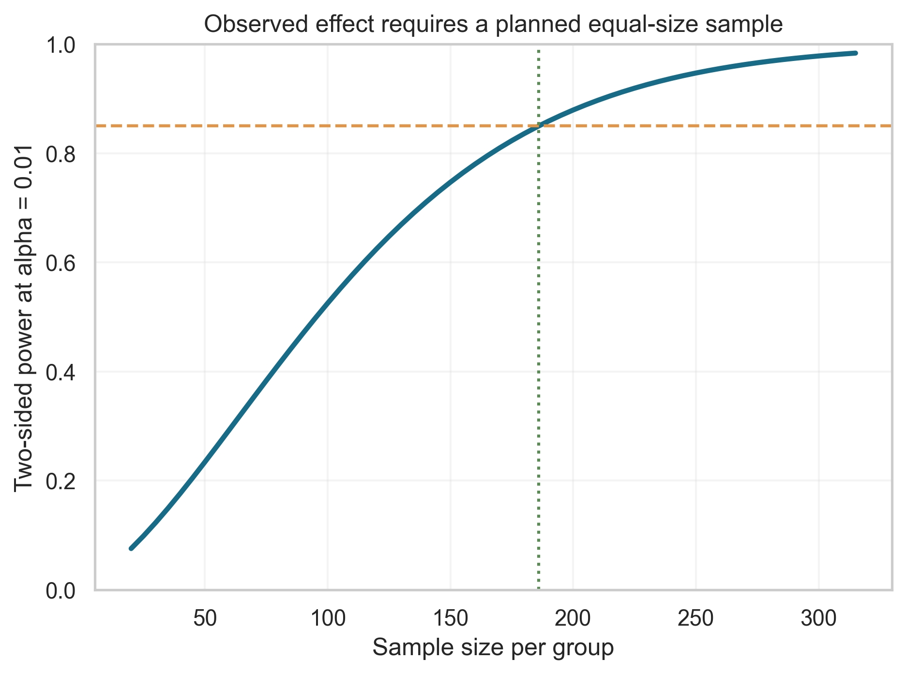
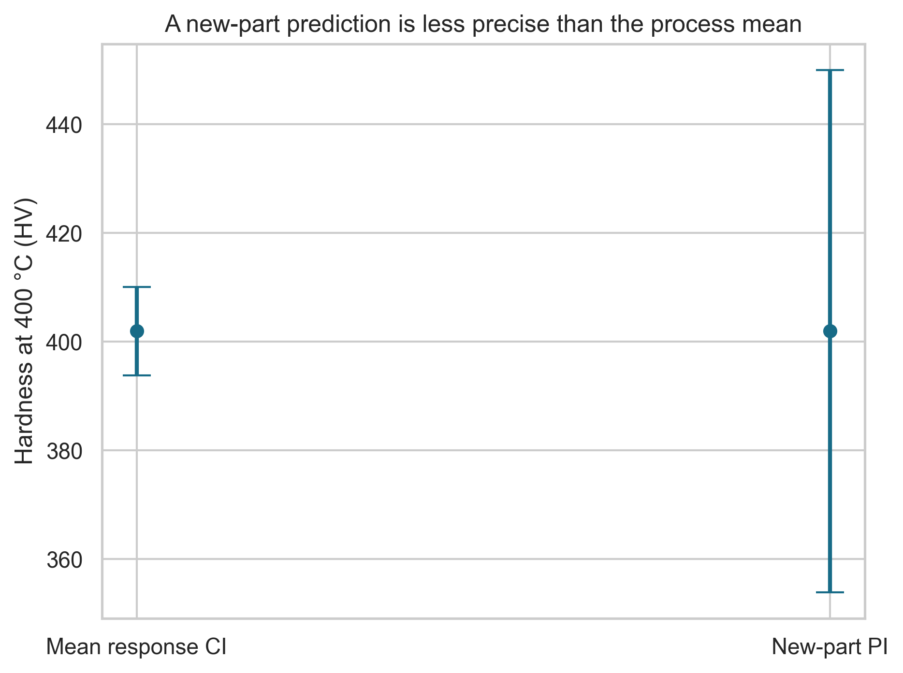
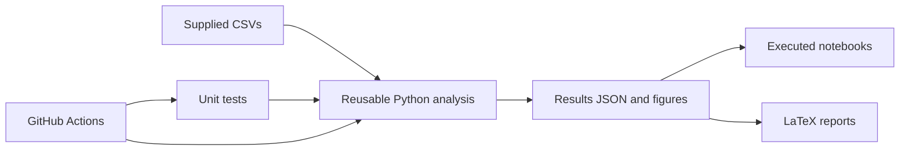

# Engineering Statistics Portfolio

**Two reproducible, English-language statistical inference projects by Mahdi Abazari Aghdam · Sharif University of Technology**

From careful hypothesis testing to first-principles estimation and regression, this repository connects mathematical derivations, Python implementations, simulation, visual diagnostics, and written interpretation. Each phase stands on its own; together they show a complete statistical workflow.

**Start here:** [Phase 1 report](phase1/reports/latex/main.pdf) · [Phase 2 report](phase2/reports/latex/main.pdf) · [Phase 1 notebook](phase1/notebooks/phase1_applied_inference.ipynb) · [Phase 2 notebook](phase2/notebooks/phase2_estimation_regression.ipynb)

| Phase 1: power and study design | Phase 2: prediction uncertainty |
| :---: | :---: |
| [](phase1/reports/figures/09_power_curve.png) | [](phase2/reports/figures/13_prediction_intervals.png) |

## Projects at a glance

| | [Phase 1: Applied Statistical Inference](phase1/README.md) | [Phase 2: Estimation Theory & Regression](phase2/README.md) |
| --- | --- | --- |
| Questions | Five case studies: lifestyle, acceptance sampling, normal theory, test preparation, and performance indices | Sixteen tasks across component reliability and heat-treatment process data |
| Methods | Welch and Mann–Whitney tests, Holm adjustment, bootstrap intervals, OC curves, transformations, power analysis | MoM/MLE, Cramér–Rao bound, Monte Carlo, exact and bootstrap intervals, direct-sum OLS, diagnostics, prediction |
| Data | Two supplied, publicly available example datasets | Two small course-provided engineering datasets |
| Evidence | [Executed notebook](phase1/notebooks/phase1_applied_inference.ipynb), [code](phase1/src/), [figures](phase1/reports/figures/), [14-page report](phase1/reports/latex/main.pdf) | [Executed notebook](phase2/notebooks/phase2_estimation_regression.ipynb), [code](phase2/src/), [figures](phase2/reports/figures/), [16-page report](phase2/reports/latex/main.pdf) |
| Verification | [Unit tests](phase1/tests/) and reproducible JSON outputs | [Unit tests](phase2/tests/) and numerical checks against library fits |

## What the analysis shows

- **Phase 1:** The observed test-preparation groups differ by **5.62 math points** on average, but the comparison is observational. The design calculation needs **186 participants per group** for approximately 85% power at two-sided α = 0.01, conditional on the observed effect. A four-record sleep subgroup is identified as too fragile for a strong conclusion. The acceptance-sampling OC curve implements the original rule: reject a lot when at least four sample items are defective.
- **Phase 2:** The component-lifetime sample gives a mean of **356.95 hours**. An exact 95% interval under the exponential model is **[281.41, 467.76] hours**. Direct-sum regression estimates **hardness = 108.602 + 0.73332 × temperature** with **R² = 0.9338**. At 400 °C, the interval for one *new part* is wider than the confidence interval for the *mean response*.

These are results for supplied datasets and stated models. The phase reports and notebooks provide assumptions, diagnostics, uncertainty, and simulation settings alongside the numbers.

## How the pieces connect



The notebooks call the same analysis functions that generate the figures and report values. The reports use generated LaTeX macros for numerical results, reducing manual transcription errors. Fixed random seeds make simulation output repeatable.

## Reproduce and review

Use **Python 3.13**. Each phase has exact dependency pins and a detailed [Phase 1 guide](phase1/README.md) or [Phase 2 guide](phase2/README.md). From either phase directory:

```powershell
python -m pip install -r requirements.txt
python -m unittest discover -s tests -v
python -m src.run_all
python build_notebook.py
python build_report.py
```

The supplied PDFs can be read immediately. To rebuild a PDF, run `pdflatex -interaction=nonstopmode -halt-on-error main.tex` twice from that phase's `reports/latex` directory. The [root GitHub Actions workflow](.github/workflows/portfolio.yml) runs tests and regenerates Python results for both phases on pushes and pull requests.

## Data, attribution, and scope

- Phase 1 uses the [Sleep Health and Lifestyle dataset](https://www.kaggle.com/datasets/uom190346a/sleep-health-and-lifestyle-dataset) and [Students Performance in Exams](https://www.kaggle.com/datasets/spscientist/students-performance-in-exams). Their source and licensing are separate from this project's MIT-licensed code and documentation.
- Phase 2 uses small course-provided lifetime and process files. The repository includes the CSV inputs needed to reproduce the analyses; no database or private records are included.
- The sleep and exam examples are synthetic or generated, and the engineering files are teaching data. The findings demonstrate methods, not clinical, educational, or industrial causal effects.
- Original assignment documents, older submissions, temporary LaTeX files, and Python caches are excluded from the published repository.

**Author:** Mahdi Abazari Aghdam · Engineering Statistics, Sharif University of Technology · 2026
